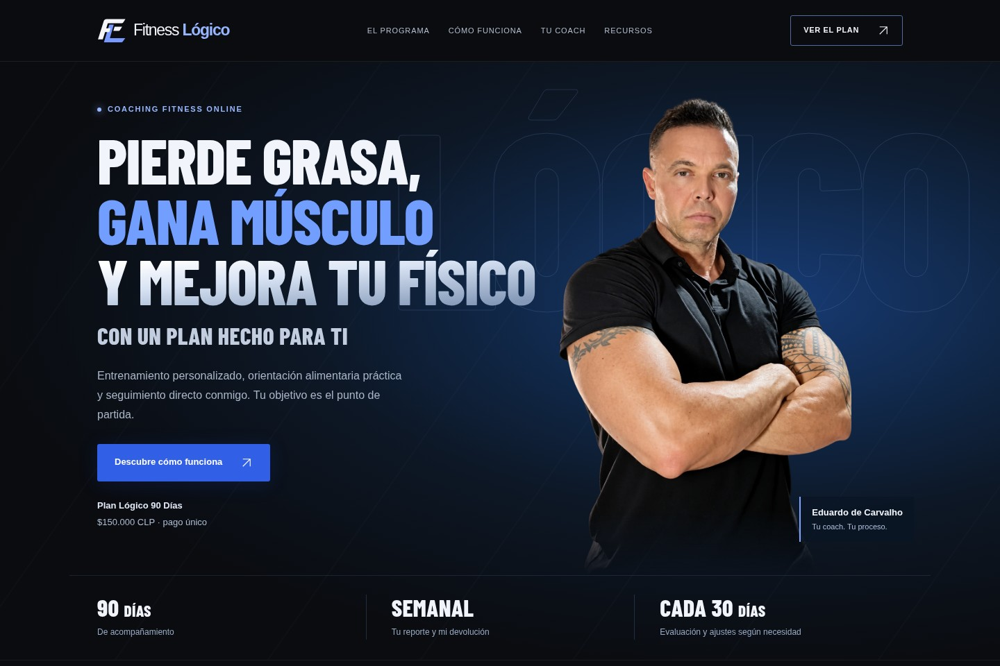
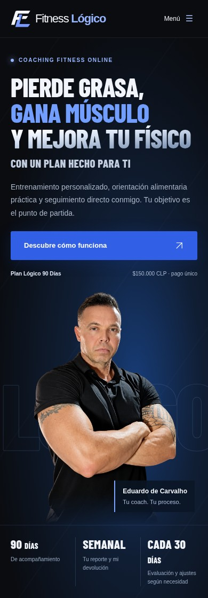

# Rediseño de Fitness Lógico

La nueva portada integra la fotografía de Eduardo sobre un fondo azul oscuro, con títulos de acabado metálico y el logo azul existente. La referencia visual es la portada del [proyecto de Behance](https://www.behance.net/gallery/245666467/Personal-Trainer-Website-UI-Design-Fitness); el contenido presenta los servicios reales de Fitness Lógico.

El recorrido principal es conocer el programa, entender el proceso, revisar precio y alcance, y consultar por WhatsApp. La calculadora y el reto conservan su funcionamiento y comparten la nueva apariencia.

## Vistas para revisar

Estas capturas muestran la rama de rediseño. La web pública cambia después de aprobar e incorporar el pull request y completar el despliegue.

### Escritorio

### Celular

## Comprobaciones

- Las tres páginas se revisaron en Chromium a 320, 390, 768 y 1440 píxeles, sin desbordamientos horizontales. El ajuste del título de la calculadora también se verificó a 360 píxeles.
- Ambas calculadoras validan campos vacíos y muestran los resultados esperados de mantenimiento, déficit y superávit; editar los datos oculta el resultado anterior.
- Menú móvil, navegación por secciones, preguntas desplegables, reto por enlace directo, copia de correo y recursos locales comprobados.
- Se conservan $150.000 CLP por 90 días, plazo de entrega, alcance del seguimiento y condiciones del servicio.
- Los enlaces de Instagram están en [instagram.md](instagram.md). No se ha añadido analítica ni captura de datos.

La tipografía Barlow Condensed se sirve desde el sitio con su licencia OFL. La imagen de portada es un recorte con fondo transparente preparado a partir de la fotografía existente; el original permanece en el repositorio.
